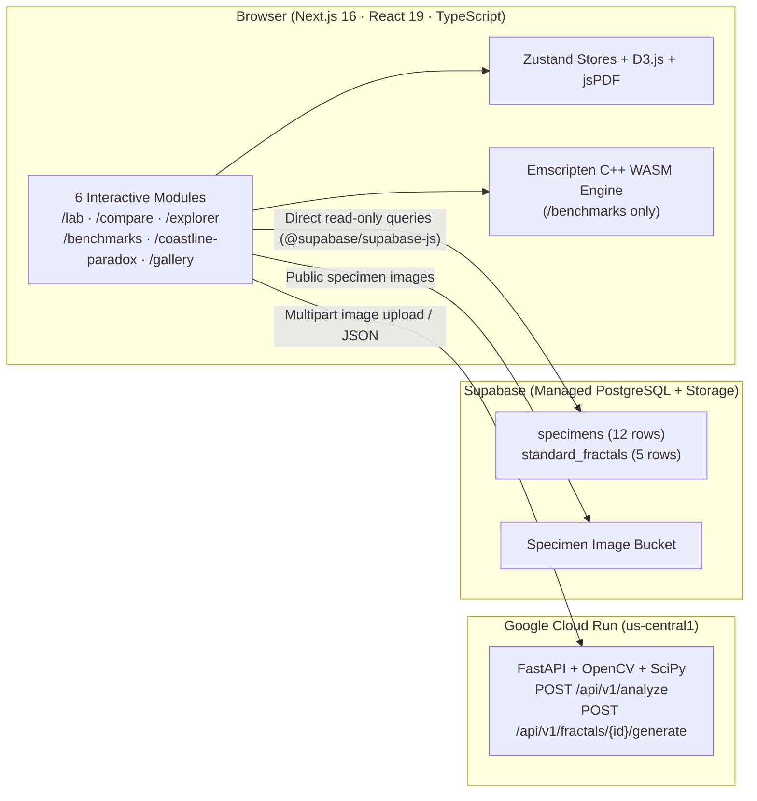

# FractalVision Lab — Frontend

[](https://fractalvision-frontend.vercel.app)
[](https://fractalvision-backend-43382945646.us-central1.run.app/api/v1/health)
[](https://nextjs.org/)
[](https://www.typescriptlang.org/)


Interactive scientific web application for estimating the box-counting (Minkowski–Bouligand) fractal dimension of natural patterns and standard mathematical fractals.

**Live Application:** [https://fractalvision-frontend.vercel.app](https://fractalvision-frontend.vercel.app)  
**Backend Repository:** [M3hul-raj/fractalvision-backend](https://github.com/M3hul-raj/fractalvision-backend)

---

## Architecture



---

## Application Modules (6 Interactive + 3 Static)

The app exposes **9 Next.js App Router pages**: **6 interactive modules** and **3 informational/documentation pages**.

| # | Route | Kind | What It Does |
|---:|---|---|---|
| 1 | `/lab` | Interactive | Upload an image, configure 3 analysis modes × 3 thresholding methods + blur/denoise/sensitivity, inspect grid overlays (`PipelineViewer` + `BoxSizeSlider`), toggle scales (`ScaleRangeSelector` live client OLS), overlay specimens, and export a 2-page PDF. |
| 2 | `/compare` | Interactive | Side-by-side dual-slot (`A`/`B`) comparison of uploaded images or gallery specimens with independent preprocessing, overlaid `DualLogLogChart`, $\Delta D$ metrics, and Comparison PDF export. |
| 3 | `/explorer` | Interactive | Generate 5 standard mathematical fractals (Cantor Set, Koch Curve, Koch Snowflake, Sierpiński Triangle, Sierpiński Carpet) across configurable iterations, inspect in a pan/zoom lightbox, and compare computed vs theoretical $D$. |
| 4 | `/benchmarks` | Interactive | Client-side Otsu preprocessing and `performance.now()` comparison between pure TypeScript (`boxCountingJs.ts`) and Emscripten C++ WebAssembly (`box_counting.wasm`). |
| 5 | `/coastline-paradox` | Interactive | Client-side Richardson coastline paradox simulation (~25,601-point fractal coastline, greedy ruler walker 5–100 px, interactive HTML5 Canvas zoom/pan + minimap, D3 power-law curve). |
| 6 | `/gallery` | Interactive | Browse, filter (`All`/`Leaves`/`Coastlines`), and sort 12 dissertation specimens stored in Supabase Postgres, with modal inspection and inline D3 log-log plots. |
| — | `/`, `/methodology`, `/limitations` | Static | Landing overview and 2 scientific documentation pages. |

---

## Tech Stack (Actual)

| Layer | Technology | Version |
|---|---|---|
| Framework | Next.js (App Router) | 16.2.7 |
| UI Library | React | 19.2.4 |
| Language | TypeScript (strict) | ^5 |
| Styling | Tailwind CSS | v4 |
| Visualization | D3.js + HTML5 Canvas | ^7.9.0 |
| State Management | Zustand | ^5.0.14 |
| Animation | Framer Motion | ^12.40.0 |
| PDF Export | jsPDF | ^4.2.1 |
| Database Client | `@supabase/supabase-js` | ^2.107.0 |
| WASM Toolchain | Emscripten (`emcc`) | 6.0.0 |
| Testing | Vitest | ^4.1.10 |

---

## WASM vs JavaScript Benchmark

Reproducible benchmark running `src/lib/wasm/boxCountingJs.ts` against `public/wasm/box_counting.{js,wasm}` in Node `v24.13.0` (`V8 13.6.233.17-node.37`, `win32 x64`, `Intel i5-12500H`, 10 warm-up runs, median of 30 alternating runs):

| Case | JS Median | WASM Median | Ratio (JS / WASM) | Winner |
|---|---:|---:|---:|---|
| `128×128 (sparse 1%)` | 0.040 ms | 0.073 ms | 0.55× | **JS (1.83×)** |
| `128×128 (dense 100%)` | 0.008 ms | 0.032 ms | 0.25× | **JS (4.02×)** |
| `256×256 (dense 100%)` | 0.029 ms | 0.041 ms | 0.71× | **JS (1.42×)** |
| `512×512 (sparse 1%)` | 0.591 ms | 0.352 ms | 1.68× | WASM (1.68×) |
| `1024×1024 (sparse 1%)` | 2.402 ms | 1.426 ms | 1.68× | WASM (1.68×) |
| `2048×2048 (sparse 1%)` | 10.121 ms | 6.208 ms | 1.63× | WASM (1.63×) |
| `cantor_set (1024×1024)` | 6.358 ms | 4.197 ms | 1.51× | WASM (1.51×) |
| `koch_curve (1024×1024)` | 6.012 ms | 4.156 ms | 1.45× | WASM (1.45×) |
| `sierpinski_triangle (1024×1024)` | 4.733 ms | 3.317 ms | 1.43× | WASM (1.43×) |
| `sierpinski_carpet (1024×1024)` | 3.848 ms | 2.587 ms | 1.49× | WASM (1.49×) |

**Key takeaway:** V8 TurboFan JIT executes tight loops over `Uint8Array` efficiently, so on small (`128×128`) or early-exit dense (`256×256 dense`) images, JS beats WASM because `runBoxCountingWasm` pays `_malloc`, `HEAPU8.set`, C++ `std::ostringstream` JSON serialization/re-parsing, `UTF8ToString`, and `JSON.parse()` on every call. Full tables and breakdown: [docs/BENCHMARK.md](docs/BENCHMARK.md).

---

## How to Run Locally

```bash
git clone https://github.com/M3hul-raj/fractalvision-frontend.git
cd fractalvision-frontend
npm install
cp .env.example .env.local
npm run dev
# http://localhost:3000
```

Environment variables (`.env.local`):

| Variable | Required | Description |
|---|---|---|
| `NEXT_PUBLIC_API_URL` | Yes | Backend API base URL (`http://localhost:8000/api/v1` for local dev) |
| `NEXT_PUBLIC_SUPABASE_URL` | Optional | Supabase project URL (needed only for `/gallery` and specimen picker) |
| `NEXT_PUBLIC_SUPABASE_ANON_KEY` | Optional | Supabase public read-only anon key |

---

## Test, Quality & Benchmark Commands

```bash
npm run lint       # ESLint (0 errors, 0 warnings)
npm run typecheck  # tsc --noEmit
npm run test       # Vitest (9 tests across 3 files: boxCountingJs, wasmConsistency, apiClient)
npm run build      # Next.js production build
npm run benchmark  # Reproducible JS vs WASM benchmark across sizes & fixtures
```

---

## Scientific & Engineering Limitations

- **Raster quantization & finite scale range:** Box-counting operates on pixel grids resized to max `1024 px` across powers of 2 (`4..min(w,h)/4`). Diagonal aliasing and finite iteration depths produce 1–5% error vs continuous Hausdorff/theoretical dimensions; client-side JS/WASM uses a single grid origin (causing ~0.10 underestimation on `sierpinski_carpet`), whereas the backend uses 4 grid offsets.
- **Preprocessing sensitivity:** Computed $D$ describes the *binarized mask*, not the raw physical specimen; illumination gradients, noise, or manual threshold choices shift $D$.
- **WASM scope & overhead:** WASM is used only on `/benchmarks`; it uses JSON string marshaling across the JS–WASM boundary, limiting speedup to ~1.4×–1.7× on 1024×1024 inputs.
- **No server-side analysis persistence:** Results live only in browser Zustand/session storage and PDF exports; `/gallery` reads a static 12-specimen dataset.
- **Backend cold starts / hosting constraints:** Cloud Run scales to zero when idle; keep-alive cron pings reduce cold starts, while Vercel Hobby requires strictly non-commercial usage.
